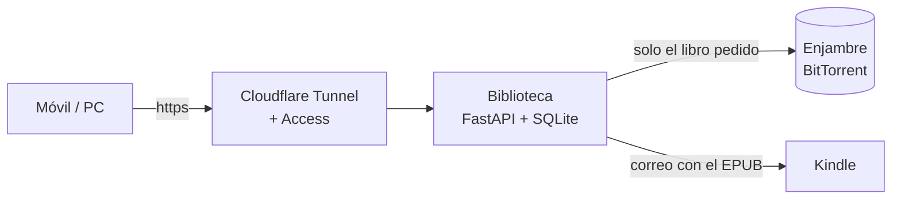

# Biblioteca

Biblioteca para casa: un buscador web de libros que se alimenta de un torrent
(enlace magnet) y manda cualquier libro al Kindle con un botón. Pensada para un
mini PC con Docker y publicada en `https://biblioteca.baltajmn.dev`.

- **Ocupa muy poco.** Nunca descarga el torrent entero. Solo lee la lista de
  ficheros para montar el catálogo y, cuando alguien pide un libro, descarga
  **solo ese libro**. Tampoco guarda libros: se borran en cuanto llegan al Kindle.
- **Sin contraseñas propias.** Quién entra lo decide Cloudflare Access, igual que
  en el resto de webs de `baltajmn.dev`.
- **Buscador rápido** por título, autor o serie, sin importar las tildes. Funciona
  en el móvil y se puede instalar como app en la pantalla de inicio.
- **Enviar al Kindle.** Antes de enviarlo por correo a tu dirección `@kindle.com`,
  arregla los fallos típicos por los que Amazon rechaza los EPUB.
- **Siempre al día.** Cuando salga una versión nueva del torrent, añades el magnet
  nuevo (o se añade solo desde un feed). Los libros repetidos se fusionan.
- Lee los nombres al estilo ePubLibre (`Apellido, Nombre - [Serie 01] Título (r1.2).epub`),
  bibliotecas de Calibre (usa su `metadata.db`: sinopsis, series, etiquetas, ISBN)
  y carpetas por autor.



## Cómo funciona

1. Al añadir un magnet se descarga solo el índice del torrent (la lista de
   ficheros, unos pocos MB) y se genera un catálogo SQLite con búsqueda de texto
   completo.
2. Cuando pulsas **Enviar al Kindle** o **Descargar**, la app añade el torrent con
   todos los ficheros desactivados salvo ese libro y lo descarga en una carpeta
   temporal.
3. **Enviar al Kindle:** en cuanto sale el correo se borran el libro y los datos
   temporales del torrent. **Descargar:** el fichero se borra
   `DOWNLOAD_KEEP_MINUTES` minutos (10 por defecto) después de entregarlo al
   navegador, o al cabo de una hora si nadie lo recoge. Si vuelves a pedir el
   mismo libro, se descarga otra vez.
4. Lo único que se conserva de cada libro pedido es una portada pequeña (unos
   20 KB) y la sinopsis, para que la ficha quede completa.

Medido con un torrent simulado de **150.000 libros (165 GB)**:

| | |
|---|---|
| Catálogo en disco | **51 MB** |
| Indexado inicial | 16 s |
| Búsqueda | 30–50 ms |
| Libros guardados | ninguno (solo los que se están enviando en ese momento) |

## Instalación en el mini PC

Necesitas Docker con el plugin Compose, el dominio en Cloudflare (`baltajmn.dev`
ya lo está) y una cuenta de correo para enviar al Kindle (Gmail sirve).

### 1. Descargar y configurar

```bash
git clone https://github.com/baltajmn/biblioteca.git
cd biblioteca
cp .env.example .env
nano .env
```

Los valores importantes son estos:

- `MAGNETS`: el magnet del catálogo. También lo puedes añadir luego desde **Ajustes**.
- `SMTP_*`: el correo desde el que se envía a los Kindle (ver el paso 2).
- `COMPOSE_PROFILES` y `CLOUDFLARE_TUNNEL_TOKEN`: solo si usas el túnel incluido
  (ver el paso 3).

### 2. Correo para Send to Kindle

1. En Gmail, activa la verificación en dos pasos y crea una **contraseña de
   aplicación** en <https://myaccount.google.com/apppasswords>. Ponla en
   `SMTP_PASSWORD` y tu dirección en `SMTP_USER` y `SMTP_FROM`.
2. En Amazon, ve a **Gestionar contenido y dispositivos → Preferencias →
   Configuración de documentos personales**:
   - apunta la dirección `@kindle.com` de cada Kindle (la añadirás en la web);
   - en **Lista de e-mails aprobados**, añade tu `SMTP_FROM`. Si no está ahí,
     Amazon descarta los envíos sin avisar.

### 3. Publicarlo en biblioteca.baltajmn.dev (Cloudflare Tunnel + Access)

La app no tiene usuarios ni contraseña: se entra solo a través de Cloudflare
Access. Por seguridad, **rechaza cualquier petición que no venga autenticada por
Access** (error 403), y el puerto 8080 solo escucha en el propio mini PC. Así, si
Access se desconfigura algún día, la biblioteca no queda abierta a Internet.

**Túnel.** Elige una de estas dos opciones:

- **Ya tienes un túnel para tus otras webs** (lo normal). En
  <https://one.dash.cloudflare.com> → **Networks → Tunnels → (tu túnel) → Public
  Hostname**, añade el subdominio `biblioteca`, el dominio `baltajmn.dev` y este
  servicio:
  - `HTTP` → `localhost:8080` si `cloudflared` está instalado en el sistema del
    mini PC;
  - si tu `cloudflared` corre en otro contenedor Docker, conéctalo a la red de
    este proyecto (`docker network connect biblioteca_default <contenedor>`) y
    usa `HTTP` → `biblioteca:8080`.

  En el `.env`, deja `COMPOSE_PROFILES` vacío para no arrancar un segundo túnel.
- **Túnel nuevo solo para la biblioteca.** Crea un túnel (**Networks → Tunnels →
  Create a tunnel → Cloudflared**) y copia el token que aparece después de
  `--token` en `CLOUDFLARE_TUNNEL_TOKEN`, con `COMPOSE_PROFILES=tunnel`. El
  contenedor `cloudflared` ya está en el `docker-compose.yml`. En **Public
  Hostname** usa `biblioteca.baltajmn.dev` → `HTTP` → `biblioteca:8080`.

**Access (obligatorio).** En **Access → Applications → Add an application →
Self-hosted**, añade `biblioteca.baltajmn.dev`. Puedes reutilizar la política que
ya usas en las otras webs, o crear una *Allow* con los correos que quieras dejar
entrar. **Para dar acceso a alguien nuevo, añade su correo a esa política en
Cloudflare**: la app no guarda ninguna lista de usuarios.

### 4. Arrancar

```bash
docker compose up -d --build
docker compose logs -f biblioteca   # para ver qué hace
```

Abre `https://biblioteca.baltajmn.dev`. En **Ajustes**:

1. Añade los Kindles de cada persona (nombre + dirección `@kindle.com`). Puedes
   añadir todos los que quieras; al enviar un libro se elige a cuál.
2. Si no lo pusiste en `MAGNETS`, pega el magnet. Pasará por *Obteniendo lista de
   ficheros* → *Indexando* → *Listo*. El primer paso puede tardar unos minutos,
   según cuánta gente esté compartiendo el torrent.
3. Pulsa **Enviarme un correo de prueba** para comprobar el SMTP.

**Opcional:** abre el puerto **6881 (TCP y UDP)** del router hacia el mini PC.
No es imprescindible, pero así se conecta a más gente y las descargas van más rápido.

## Uso

- Escribe en el buscador; los resultados se actualizan mientras tecleas.
- Pulsa el nombre del autor o de la serie para ver todos sus libros.
- **Enviar al Kindle**: si hay varios Kindles, pregunta a cuál (y recuerda el
  último). El libro aparece en el Kindle en uno o dos minutos.
- **EPUB/PDF/MOBI**: descarga el fichero. La descarga también funciona sin
  JavaScript, así que sirve en navegadores muy básicos.

## Mantenerlo actualizado

- **Nuevas versiones del torrent:** añade el magnet nuevo en **Ajustes**. Los
  libros que ya existían se fusionan (no se duplican) y siempre se descarga de la
  fuente más reciente; si nadie la comparte, se prueba con la anterior. Cuando la
  nueva esté *Lista*, puedes quitar la antigua.
- **Automático:** si los magnets nuevos se publican en una página web, un fichero
  de texto o un RSS, pon esa URL en `MAGNET_FEED_URL`. Se revisa cada
  `MAGNET_FEED_INTERVAL_HOURS` horas y cada magnet nuevo se añade solo. También
  hay un botón **Comprobar ahora** en Ajustes.
- **Actualizar la app:** `git pull && docker compose up -d --build`.

## Copia de seguridad

Todo vive en el volumen `biblioteca-data`: catálogo, Kindles y portadas.

```bash
docker run --rm -v biblioteca_biblioteca-data:/data -v "$PWD":/backup alpine \
  tar czf /backup/biblioteca-data.tgz -C /data .
```

## Problemas frecuentes

| Síntoma | Qué hacer |
|---|---|
| «Nadie comparte este libro ahora mismo» | Ninguna persona del enjambre tiene ese fichero en este momento. Prueba más tarde; abrir el puerto 6881 ayuda. |
| Se queda en «Obteniendo lista de ficheros» | Todavía no ha encontrado a nadie con el torrent. Revisa los logs y la conexión; el número de conexiones aparece en Ajustes. |
| El libro no llega al Kindle | Comprueba que `SMTP_FROM` está en la lista de e-mails aprobados de Amazon y revisa el correo: Amazon avisa cuando no puede convertir un documento. El límite es 25 MB por libro. |
| El botón Kindle está desactivado | Ese libro solo está en MOBI/AZW3, formatos que Amazon ya no acepta por correo. Puedes descargarlo y pasarlo por cable. |
| «Esta web solo está disponible a través de Cloudflare Access» | La petición llegó sin pasar por Access: revisa que la aplicación de Access cubre `biblioteca.baltajmn.dev`. |
| Avisos de `portmap`/UPnP en los logs | Son normales en Docker: el reenvío automático de puertos no funciona dentro del contenedor. |

## Desarrollo

```bash
python3 -m venv .venv && . .venv/bin/activate
pip install -r requirements-dev.txt
pytest                                   # 21 tests, sin conexión a Internet
DATA_DIR=./data CLOUDFLARE_ACCESS_REQUIRED=false uvicorn app.main:app --reload --port 8080
```

Los tests montan un *seeder* BitTorrent local con una biblioteca falsa y un
servidor SMTP de pega. Comprueban de punta a punta el indexado, la búsqueda, la
descarga de un único fichero, la limpieza de temporales, el arreglo de EPUB para
Kindle, la importación desde Calibre y los reinicios.

Estructura:

```
app/
  main.py       rutas web, ajustes y comprobación de Cloudflare Access
  torrents.py   sesión libtorrent: metadatos y descargas bajo demanda
  indexer.py    ficheros del torrent → libros (con soporte de Calibre)
  parsing.py    título/autor/serie a partir del nombre del fichero
  db.py         catálogo SQLite + FTS5
  service.py    trabajos de descarga y envío con progreso
  epub.py       metadatos, portadas y arreglos para Kindle
  kindle.py     envío por SMTP
  feed.py       búsqueda periódica de magnets nuevos
```

## Nota legal

La app sirve para cualquier torrent; no está atada a ninguno en concreto. Ten en
cuenta que la mayoría de los libros de las colecciones que circulan por Telegram
tienen derechos de autor, y que en España descargarlos y compartirlos por
BitTorrent sin permiso no está cubierto por la copia privada. Mientras se
descarga un libro, BitTorrent también sube trozos a otras personas
(`TORRENT_UPLOAD_LIMIT_KBPS` lo limita). Mantén la web privada con Cloudflare
Access: abrirla al público sería redistribuir los libros.
